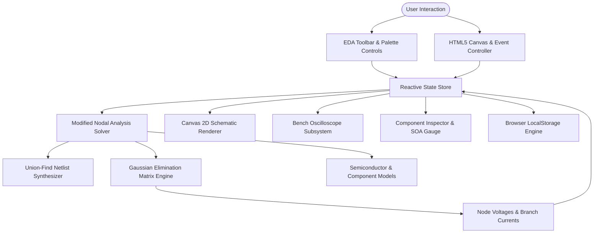

# System Architecture & Technical Specifications

## 1. High-Level Architecture Overview



The system operates around a single deterministic state container (`state`), evaluating circuit topology and physical matrices at 60 fps inside a `requestAnimationFrame` render loop.

## 2. Technology Stack Selection

| Layer | Technology | Version | Purpose |
| :--- | :--- | :--- | :--- |
| **Language Runtime** | Vanilla JavaScript (ES6+) | Native Browser | High-performance, zero-transpile execution |
| **Canvas Graphic Engine** | HTML5 Canvas 2D Context | Standard W3C | Low-latency 60fps schematic and particle rendering |
| **Styling Framework** | Tailwind CSS | 3.x (CDN) | Utility-first dark graphite engineering theme |
| **Iconography** | FontAwesome Free | 6.4.0 (CDN) | EDA workstation iconography and symbol accents |
| **Typography** | Inter & JetBrains Mono | Google Fonts | High-contrast UI and monospaced engineering telemetry |
| **Persistence Engine** | Web Storage API (LocalStorage) | Native W3C | Instant schema persistence and session restore |
| **Verification Runner** | Node.js Test Harness (VM sandbox) | 20.x+ | Headless integration and physical validation tests |

## 3. Directory Conventions

ElectroSim Pro enforces a strictly self-contained single-file root layout accompanied by test and documentation suites:

```plaintext
electro/
├── index.html                   # Core application (Zero-dependency single-file EDA workstation)
├── knowledge_transfer.md        # Comprehensive engineering knowledge transfer handbook
├── docs/                        # Complete 6-file Vibe Coding documentation suite
│   ├── PRD.md                   # Product requirements and user stories
│   ├── ARCHITECTURE.md          # Technical architecture and solver mathematics
│   ├── RULES.md                 # Non-negotiable engineering rules and standards
│   ├── DESIGN.md                # Design tokens, typography, and color palettes
│   ├── TASKS.md                 # Roadmap and task execution tracker
│   └── MEMORY.md                # Architectural Decision Records (ADRs) and solved traps
└── scratch/                     # Automated test suites & validation harnesses
    ├── e2e_integration_test.js  # Headless MNA solver, rotation, and persistence tests
    ├── test_embedded_features.js# Active semiconductor & protection circuit tests
    ├── test_datasheet_features.js# Real datasheets coverage & SOA gauge tests
    ├── test_component_details.js# Resistor color codes and EIA marking tests
    ├── test_icon_buttons.js     # DOM validation and icon-only button checks
    └── test_ui_ux_redesign.js   # Workstation layout, search, and HUD tests
```

## 4. Subsystem Architectures

### 4.1 Electrical Simulation Engine (Modified Nodal Analysis)
Circuit analysis evaluates Kirchhoff's Current Law (KCL) and Kirchhoff's Voltage Law (KVL) via the matrix equation:

$$A \cdot x = z$$

Where:
- **$G$ Matrix ($N \times N$):** Conductance values ($1/R$) connecting node pairs.
- **$B$ Matrix ($N \times M$):** Incident connection matrix for independent voltage sources.
- **$C$ Matrix ($M \times N$):** Transpose of $B$ mapping node potentials to branch constraints.
- **$D$ Matrix ($M \times M$):** Source internal resistance ($R_{int} = 1.5\ \Omega$ for batteries).
- **$x$ Vector ($[N + M]$):** Unknown node voltages followed by unknown branch currents.
- **$z$ Vector ($[N + M]$):** Known independent source voltages and currents.

### 4.2 Semiconductor Physics Modeling
Non-linear components are solved iteratively:
1. **1N4007 Diode:** Modeled with Shockley diode behavior ($V_f = 0.7\text{ V}$, dynamic junction resistance $R_j = 10\ \Omega$, reverse leakage $1\text{ M}\Omega$).
2. **BZX55C Zener Diode:** Forward conduction at $0.7\text{ V}$, reverse breakdown clamp at $5.1\text{ V}$ with $R_z = 5\ \Omega$.
3. **2N2222 NPN BJT:** Multi-state transistor model evaluating cutoff ($V_{BE} < 0.65\text{ V}$), forward-active amplification ($I_C = \beta \cdot I_B$), and saturation ($V_{CE(sat)} = 0.2\text{ V}$).
4. **0154.500DR Polyfuse:** Dynamic thermal trip model tripping into high-resistance state ($1\text{ M}\Omega$) when current exceeds continuous rating ($500\text{ mA}$).

### 4.3 Schematic Canvas Engine
- **Coordinate Transformations:** Canvas viewport supports arbitrary panning (`state.panX, state.panY`) and zoom scaling (`state.zoom` between 0.4x and 2.5x).
- **Orthogonal Wire Routing:** Manhattan A*-style path generator with $20\text{ px}$ terminal stubs and bounding box obstacle clearance.
- **Particle Drift Animation:** Drift particles spaced along wire paths, moving with velocity:

$$v_{drift} = \text{clamp}(I \cdot 40, -15, 15)\text{ px/frame}$$

### 4.4 Bench Oscilloscope Subsystem
- **Phosphor Dual-Trace Monitor:** CH1 Voltage (Cyan `#38bdf8`) and CH2 Current (Emerald `#34d399`) buffered across canvas width.
- **Graticule Subdivisions:** $8 \times 4$ precision division grid with center crosshair tick marks (5 subdivisions per division).
- **Digital Telemetry Bar:** Peak voltage, peak current, active power dissipation, and probe target.

### 4.5 Microcontroller MNA Companion Modeling & IoT Subsystem
Embedded boards (Arduino Uno R3 and ESP32 NodeMCU) and IoT peripherals interface with the linear MNA solver through physical companion network equations:
1. **Regulated DC Power Rails:** Arduino `5V` and `3V3` and ESP32 `3V3` pins are stamped into the matrix as independent DC voltage sources with small internal series output impedance ($R_{out} = 0.1\ \Omega$).
2. **Digital GPIO Output Drives:** Arduino `D13`, `D9`, `D2` and ESP32 `D2`, `D4` are stamped as voltage sources referenced to circuit GND with $25\ \Omega$ CMOS output drive resistance:
   - D13 blinks at $1\text{ Hz}$ or stays static (HIGH $5\text{V}$, LOW $0\text{V}$), synchronized with an onboard teal 'L' LED indicator.
   - D9 outputs PWM duty-proportional potential ($V_{eff} = 5.0\text{V} \times \text{duty}/100$).
3. **High-Impedance ADC Sampling Nodes:** Arduino `A0` and ESP32 `VN` (GPIO36) are stamped with $10\text{ M}\Omega$ input impedance conductances ($G = 10^{-7}\ \mho$). The post-solve node potential is sampled and quantized:
   - Arduino A0 (10-bit): $\text{Code} = \text{round}\left(\text{clamp}\left(\frac{V_{A0}}{5.0}, 0, 1\right) \times 1023\right)$.
   - ESP32 VN (12-bit SAR): $\text{Code} = \text{round}\left(\text{clamp}\left(\frac{V_{VN}}{3.3}, 0, 1\right) \times 4095\right)$.
4. **Photoconductive LDR Response:** The CdS photoresistor dynamically updates its channel conductance according to ambient illuminance ($E$, in lux):
   $$R_{LDR} = \text{clamp}\left(500\text{ k}\Omega \cdot (E + 1)^{-0.65},\ 20\ \Omega,\ 500\text{ k}\Omega\right),\quad G_{LDR} = \frac{1}{R_{LDR}}$$
5. **SPDT Relay Armature Isolation:** The 5V optocoupled relay models physical SPDT switching between Common (COM), Normally Open (NO), and Normally Closed (NC). When coil voltage exceeds pull-in threshold ($V_{coil} \ge 3.8\text{V}$):
   - $G_{COM-NO} = 20\ \mho\ (0.05\ \Omega)$, $G_{COM-NC} = 10^{-7}\ \mho\ (10\text{ M}\Omega)$.
   - When de-energized, conductances invert, maintaining complete galvanic isolation ($> 100\text{ M}\Omega$) between the control coil and load contacts.

### 4.6 Web Audio API & Kinematic Synthesis
1. **Acoustic Piezo Buzzer:** Uses the browser's native `AudioContext` to construct a real hardware tone generator. An `OscillatorNode` at $2.4\text{ kHz}$ connected to a soft `GainNode` ($0.035$) fires when the solved voltage drop satisfies $V_{drop} \ge 2.5\text{ V}$. An expanding ripple arc is rendered on canvas.
2. **SG90 Micro Servo Motor:** Computes 50Hz control pulse widths ($1.0\text{ ms} - 2.0\text{ ms}$) corresponding to $0^\circ - 180^\circ$ angular horn rotation. Canvas transforms dynamically rotate the white servo horn arm in real time.

### 4.7 Embedded Microcontroller Code IDE & Virtual Firmware Engine
1. **Source Transpiler (`transpileArduinoC`):** Transpiles C/C++ sketch syntax into asynchronous JavaScript generators/coroutines:
   - Replaces `#define` and preprocessor macros with JavaScript constants.
   - Converts typed variable declarations (`int`, `float`, `char`, `unsigned long`, `bool`) to `let`/`const`.
   - Wraps functions (`void setup()`, `void loop()`) into asynchronous functions (`async function setup()`, `async function loop()`).
   - Replaces blocking calls `delay(ms)` with cooperative asynchronous yields (`await delay(ms)`) scaled by `state.simSpeed`.
2. **Virtual Hardware Abstraction Layer (HAL):**
   - `digitalWrite(pin, val)`: Sets virtual pin output level, synchronizing with the MNA voltage source stamps in `circuitSolver.solve` and updating canvas indicator LEDs.
   - `digitalRead(pin)`: Interrogates the latest MNA solution vector for the pin terminal net potential ($V > 2.5\text{V} \implies \text{HIGH}$).
   - `analogRead(pin)`: Samples quantized ADC codes ($0-1023$ for Arduino A0-A5, $0-4095$ for ESP32 SAR ADCs).
   - `analogWrite(pin, val)`: Sets PWM duty cycle ($0-100\%$).
   - `Serial`: Provides a bidirectional serial stream interfaced with the IDE Serial Monitor console.

## 5. State Management & Data Flow

State is managed through a centralized store (`state`):
- `components`: Array of active circuit components with coordinates, rotation, values, and operational states.
- `wires`: Array of connection links between component terminal pairs.
- `history`: Circular undo/redo state buffer (30 snapshots).
- `scopeBuffer` & `scopeBufferI`: Ring buffers for real-time oscilloscope signal plotting.
- `selectedId` / `selectedType`: Tracked canvas entity for property inspection and editing.

Data flows unidirectionally:
`User Event (Palette / Canvas / Controls) -> State Mutation -> MNA Matrix Solve -> Canvas & Inspector Re-render`

## 6. Security & Sandboxing
- **Zero Remote Network Calls:** Entire simulator executes locally within the browser sandbox; no external telemetry or tracking.
- **Safe JSON Serialization:** Import and export validate schema versions and sanitize numeric property bounds.
- **Defensive Rendering:** Canvas coordinates are clamped to prevent infinite loop transforms or non-finite matrix determinants.

