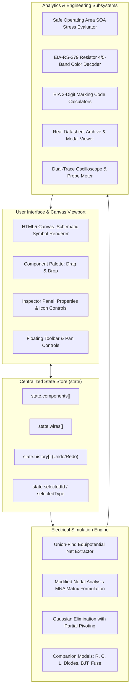

# ElectroSim Pro — Engineering Knowledge Transfer & Architecture Guide

**System:** ElectroSim Pro (Interactive Electronic Circuit Simulator & Embedded Systems Workbench)  
**Target Codebase:** [`index.html`](file:///c:/Users/Santa/OneDrive/Desktop/electro/index.html)  
**Architecture:** Single-Page Zero-Dependency Web Application  
**Primary Technologies:** HTML5 Canvas (2D API), Vanilla JavaScript (ES6+), Tailwind CSS, FontAwesome 6  
**Audience:** Incoming Software Engineers, Electronics Engineers, Embedded Systems Developers, QA Testers, and Technical Leads  

---

## Table of Contents
1. [Executive Summary & Design Philosophy](#1-executive-summary--design-philosophy)
2. [High-Level Architecture & Component Map](#2-high-level-architecture--component-map)
3. [The Electrical Simulation Engine (MNA Solver)](#3-the-electrical-simulation-engine-mna-solver)
4. [Semiconductor & Component Physics Models](#4-semiconductor--component-physics-models)
5. [Interactive Schematic Canvas & Orthogonal Wire Routing](#5-interactive-schematic-canvas--orthogonal-wire-routing)
6. [Component Inspector, Live SOA Stress & Color Coding](#6-component-inspector-live-soa-stress--color-coding)
7. [Engineering Datasheet Archive System](#7-engineering-datasheet-archive-system)
8. [Oscilloscope & Real-Time Signal Probing](#8-oscilloscope--real-time-signal-probing)
9. [State Management, History & Persistence](#9-state-management-history--persistence)
10. [Built-In Engineering Presets](#10-built-in-engineering-presets)
11. [Developer Guide: How to Add a New Component](#11-developer-guide-how-to-add-a-new-component)
12. [Automated Testing & Verification Suite](#12-automated-testing--verification-suite)
13. [Troubleshooting & Maintenance FAQ](#13-troubleshooting--maintenance-faq)
14. [Workstation UI/UX Redesign & Modern EDA Layout](#14-workstation-uiux-redesign--modern-eda-layout)
15. [Documentation Suite (Vibe Coding Standard)](#15-documentation-suite-vibe-coding-standard)

---

## 1. Executive Summary & Design Philosophy

**ElectroSim Pro** is a browser-native electronic circuit simulation environment designed to bridge the gap between academic SPICE engines and user-friendly visual schematic editors.

### Core Philosophy
1. **Zero External Dependencies / Self-Contained**: The entire application lives inside a single file, [`index.html`](file:///c:/Users/Santa/OneDrive/Desktop/electro/index.html). It requires no build pipelines (`npm`, `webpack`, `vite`), no Node.js runtime to execute, and runs instantly when opened in any modern web browser or via `file:///`.
2. **Real Physics, No Heuristics**: Circuit node voltages and branch currents are computed at 60 fps using a mathematical **Modified Nodal Analysis (MNA)** linear matrix solver with partial pivoting.
3. **Safe Operating Area (SOA) & Hardware Safety**: Components are not treated as invincible ideal models; their real-time operating parameters ($V$, $I$, $P$) are continuously evaluated against manufacturer datasheet limits.
4. **Rich Visual Feedback**: Directional particle currents depict electron drift velocity, illuminated LEDs glow dynamically according to forward current, blown fuses display broken filaments, and dynamic tooltips guide the user.

---

## 2. High-Level Architecture & Component Map

The software architecture is divided into five cleanly separated functional subsystems operating around a centralized reactive state store:



### Global Data Model

The entire simulation state is maintained in the global `state` object ([`index.html:L607`](file:///c:/Users/Santa/OneDrive/Desktop/electro/index.html#L607)):

```javascript
let state = {
    components: [],        // Array of Component instances
    wires: [],             // Array of Wire links connecting terminals
    selectedId: null,      // ID of active component or wire (e.g. 'c1', 'w1')
    selectedType: null,    // 'component' or 'wire'
    mode: 'select',        // 'select', 'pan', or 'wire'
    wiringStart: null,     // { compId, termIndex } while dragging a wire
    mouseWorld: { x, y },  // Cursor position in world coordinates
    hoveredTerminal: null, // Nearest terminal candidate for snapping
    isRunning: true,       // Simulation execution flag
    simSpeed: 1,           // Simulation speed multiplier (0.5x, 1x, 2x)
    zoom: 1,               // Canvas scale factor
    panX: 0, panY: 0,      // Canvas pan offset
    history: [],           // Undo stack (JSON snapshots)
    historyIndex: -1,      // Redo pointer
    scopeBuffer: [],       // Ring buffer of historical probe samples
    lastSolveResult: null  // Output of CircuitSolver
};
```

---

## 3. The Electrical Simulation Engine (MNA Solver)

The circuit solver is implemented as `CircuitSolver` ([`index.html:L755`](file:///c:/Users/Santa/OneDrive/Desktop/electro/index.html#L755)). It uses **Modified Nodal Analysis (MNA)**, the same algorithm powering SPICE.

### Step-by-Step Solution Pipeline:

1. **Equipotential Net Extraction (Union-Find)**:
   - Each component terminal is identified as `${comp.id}_${termIndex}`.
   - A Disjoint-Set (Union-Find) algorithm with path compression iterates through `state.wires`. Connected terminals are merged into common root nets.
   - Any net connected to a `ground` component is mapped to **Net 0** ($V_0 = 0.000\text{ V}$).
   - A high-impedance bleed conductance ($G_{\text{bleed}} = 10^{-9}\text{ S} = 1\text{ G}\Omega$) is added along matrix diagonals to guarantee invertibility for floating or disconnected subnets.

2. **Matrix Formulation ($A \cdot x = z$)**:
   - For $M$ unknown non-ground node voltages and $K$ independent voltage sources, an $(M + K) \times (M + K)$ matrix is constructed:
     $$\begin{bmatrix} G & B \\ C & D \end{bmatrix} \begin{bmatrix} v \\ j \end{bmatrix} = \begin{bmatrix} i \\ e \end{bmatrix}$$
     - $G$ ($M \times M$): Conductance matrix populated by resistive, reactive, and semiconductor companion elements.
     - $B$ ($M \times K$) & $C$ ($K \times M$): Incidence matrices connecting voltage sources to their respective positive and negative nets ($+1$ and $-1$).
     - $D$ ($K \times K$): Source internal resistance terms ($-R_{\text{int}}$).
     - $v$: Vector of unknown node voltages ($v_1, v_2, \dots, v_M$).
     - $j$: Vector of unknown branch currents through independent voltage sources.
     - $i$: Sum of independent current sources into nodes.
     - $e$: Independent source voltages ($V_{\text{nominal}}$).

3. **Gaussian Elimination with Row Pivoting**:
   - [`solveLinearMatrix(A, b)`](file:///c:/Users/Santa/OneDrive/Desktop/electro/index.html#L929) performs upper triangular elimination with partial pivoting to prevent catastrophic numerical cancellation, followed by back-substitution.

4. **Nonlinear Iteration (Newton-Raphson / Picard)**:
   - Piecewise nonlinear elements (diodes, LEDs, transistors) iterate up to `maxIter = 8` per timestep until operating voltages and currents converge.

---

## 4. Semiconductor & Component Physics Models

| Component Type | Schematic Symbol | Physical Companion Model & Equations | Absolute Maximum Limits |
| :--- | :---: | :--- | :--- |
| **Resistor** | `R` (Zigzag) | Linear Conductance: $g = \frac{1}{R}$ | $P_{\max} = 250\text{ mW}$ ($1/4\text{ W}$) |
| **Capacitor** | `C` (Parallel Plates) | Backward Euler: $g_C = \frac{C}{\Delta t}$, parallel current $I_{\text{hist}} = g_C \cdot V_C(t - \Delta t)$ | $V_{\max} = 25\text{ V DC}$ |
| **Inductor** | `L` (Coils) | Backward Euler: $g_L = \frac{\Delta t}{L}$, parallel memory current source $I_L(t - \Delta t)$ | $I_{\max} = 150\text{ mA}$ |
| **LED** | `LED` (Triangle + Rays) | Piecewise Diode: $V_F = 2.0\text{ V}$, $r_d = 15\text{ }\Omega$. Active if $V_{\text{anode}} - V_{\text{cathode}} > V_F$ | $I_{F(\max)} = 25\text{ mA}$, $P_D = 75\text{ mW}$, $V_R(\text{PIV}) = 5.0\text{ V}$ |
| **Diode** | `D` (Triangle + Bar) | 1N4007 Rectifier: $V_F = 0.7\text{ V}$, $r_d = 0.5\text{ }\Omega$. Blocks reverse up to $1000\text{ V}$ | $I_{F(\max)} = 1.0\text{ A}$, $V_{\text{RRM}} = 1000\text{ V}$ |
| **Zener Diode** | `ZD` (Z-Bent Bar) | BZX55C5V1: Forward $V_F = 0.7\text{ V}$. Reverse Zener knee: conducts if $V_R \ge 5.1\text{ V}$, $r_Z = 5.0\text{ }\Omega$ | $P_{\text{tot}} = 500\text{ mW}$, $I_Z \approx 70\text{ mA}$ |
| **NPN BJT** | `Q` (Base/Coll/Emit) | 2N2222A: $V_{BE} \ge 0.7\text{ V}$, Base drive $I_B = \frac{V_{BE}-0.7}{25\Omega}$. Saturated Collector $I_C = \min(h_{FE} \cdot I_B, \frac{V_{CE}}{R_{CE(\text{sat})}})$ | $I_{C(\max)} = 800\text{ mA}$, $P_D = 625\text{ mW}$, $V_{\text{CEO}} = 40\text{ V}$ |
| **Fuse / Polyfuse** | `FUSE` (IEC Box) | Normal: $R = 0.05\text{ }\Omega$. Tripped: $R = 100\text{ M}\Omega$. Trips when $|I| > I_{\text{rated}}$ (default $500\text{ mA}$) | $I_{\text{rated}} = 500\text{ mA}$, $V_{\max} = 125\text{ V}$ |
| **DC Voltage** | `V_DC` (+ / - Bars) | Thévenin Source: $V_{\text{nominal}} = 9\text{ V}$, internal resistance $R_{\text{int}} = 1.5\text{ }\Omega$ ($V_{\text{term}} = V_{\text{oc}} - I \cdot R_{\text{int}}$) | $I_{\max} = 100\text{ mA}$ continuous |
| **Switch** | `SW` (Blade) | Conductance Switch: Closed $R = 1\text{ m}\Omega$, Open $R = 100\text{ M}\Omega$ | $I_{\max} = 5.0\text{ A}$ |
| **Ground** | `GND` (3 Bars) | Fixed Reference: Forces Net to $0.000\text{ V}$ | $0\text{ V}$ Datum |

---

## 5. Interactive Schematic Canvas & Orthogonal Wire Routing

### A. Coordinate Transformations
All mouse events are mapped between viewport screen space and zoom/pan simulation space:
- **Screen to World** ([`index.html:L1570`](file:///c:/Users/Santa/OneDrive/Desktop/electro/index.html#L1570)):
  $$x_{\text{world}} = \frac{x_{\text{screen}} - \text{rect.left} - \text{panX}}{\text{zoom}}, \quad y_{\text{world}} = \frac{y_{\text{screen}} - \text{rect.top} - \text{panY}}{\text{zoom}}$$
- **World to Screen**:
  $$x_{\text{screen}} = x_{\text{world}} \cdot \text{zoom} + \text{panX} + \text{rect.left}$$

### B. Orthogonal Manhattan Wire Router with Obstacle Clearance
When two component pins are connected, wires are routed using strict electrical schematic design standards ([`routeOrthogonalWire`](file:///c:/Users/Santa/OneDrive/Desktop/electro/index.html#L1701)):
1. **Lead Stubs**: Wires extend outwards perpendicularly from terminal normals by a clearance stub distance ($24\text{ px}$).
2. **Component Clearance & Obstacle Avoidance**: An expanded bounding box around component bodies prevents wires from slicing through circuit symbols.
3. **Corner Bending Rules**: Routes choose clean single-bend ($L$) or dual-bend ($Z$) orthogonal paths, avoiding diagonal lines.

### C. Rotation Geometry
Components rotate in $90^\circ$ increments ($0^\circ, 90^\circ, 180^\circ, 270^\circ$). [`rotatePoint(x, y, angle)`](file:///c:/Users/Santa/OneDrive/Desktop/electro/index.html#L642) rotates terminal offsets and normal vectors:
$$x' = x \cos\theta - y \sin\theta, \quad y' = x \sin\theta + y \cos\theta$$

---

## 6. Component Inspector, Live SOA Stress & Color Coding

When a component is clicked, the right-hand **Component Inspector** panel populates with live telemetry, editable properties, and technical analytics.

```
┌─────────────────────────────────────────────────────────┐
│ COMPONENT INSPECTOR                                 c1  │
├─────────────────────────────────────────────────────────┤
│ Component Type: Resistor (0°)                           │
│ ┌─────────────────────────────────────────────────────┐ │
│ │ LIVE TELEMETRY (REAL-TIME)                          │ │
│ │ ┌──────────────┐ ┌──────────────┐ ┌───────────────┐ │ │
│ │ │ VOLTAGE (V)  │ │ CURRENT (I)  │ │ POWER (P)     │ │ │
│ │ │ 6.70 V       │ │ 20.20 mA     │ │ 135.3 mW      │ │ │
│ │ └──────────────┘ └──────────────┘ └───────────────┘ │ │
│ └─────────────────────────────────────────────────────┘ │
│ Operating Value (Ω): [ 330              Ω ]             │
│ ┌─────────────────────────────────────────────────────┐ │
│ │ RESISTOR COLOR CODE VISUALIZER (EIA-RS-279)         │ │
│ │ [SVG Cylinder Graphic: Orange Orange Brown Gold]    │ │
│ │ [Orange: 3] [Orange: 3] [Brown: x10] [Gold: ±5%]   │ │
│ │ Range: 313.5 Ω - 346.5 Ω | Max Continuous: 9.09 V   │ │
│ └─────────────────────────────────────────────────────┘ │
│ ┌─────────────────────────────────────────────────────┐ │
│ │ ⚡ OPERATIONAL STRESS (SOA)            [📄 PDF Icon] │ │
│ │ [● SAFE (54.1% Stress)]           54.1% of Rated Max │ │
│ │ ▓▓▓▓▓▓▓▓▓▓▓▓▓▓░░░░░░░░░░░░░░░░░░░░░░░░░░░░░░░░░░░░░░ │ │
│ │ Current: 20.20 mA          Power: 135.3 / 250 mW    │ │
│ └─────────────────────────────────────────────────────┘ │
└─────────────────────────────────────────────────────────┘
```

### Key Subsystems in the Inspector & Viewport:
1. **3-Card Live Telemetry Grid**: Standardized 3-column telemetry displaying Voltage (Cyan), Current (Emerald), and Power (Purple).
2. **Elevated Viewport Action Controls**: To eliminate vertical scrolling in the inspector, the **Rotate 90°** (`#btn-rotate`) and **Delete** (`#btn-delete`) buttons are positioned directly in the canvas **Floating Viewport Dock** beside the cursor.
3. **Compact Datasheet Header Button**: The engineering datasheet button (`#btn-datasheet`) is an icon-only button nested cleanly in the Operational Stress header.
4. **Safe Operating Area (SOA) Gauge**: Computes percentage of rated limit at 60 fps:
   - `IDLE (0.0% Stress)`: Slate badge (unpowered/open).
   - `SAFE (x% Stress)`: Glowing emerald badge ($0 - 75\%$).
   - `HIGH LOAD (x% Stress)`: Amber warning badge ($75 - 100\%$).
   - `OVERSTRESS (x% Stress)`: Pulsing crimson badge and bar ($> 100\%$).
   - **Hazard Alerts**: Detects reverse breakdown on LEDs ($V_R > 5.0\text{ V}$) and short-circuit overcurrent on fuses.
5. **EIA-RS-279 Resistor Color Code Visualizer**:
   - Live SVG rendering of cylindrical ceramic body with 3D gradient highlights.
   - 4-Band ($\pm 5\%$) and 5-Band ($\pm 1\%$) interactive toggle.
   - Decoded legend chips for Digit 1, Digit 2, Multiplier, and Tolerance.
   - Synchronized color band stripes rendered directly on the canvas resistor body.
6. **Capacitor & Inductor EIA 3-Digit Stamping Codes**:
   - Calculates 3-digit EIA codes (e.g. $100\mu\text{F} \to \mathbf{107}$, $10\text{mH} \to \mathbf{103}$).
   - Displays reactance @ 50 Hz ($X_C = \frac{1}{2\pi f C}$, $X_L = 2\pi f L$).

---

## 7. Engineering Datasheet Archive System

ElectroSim Pro embeds authentic manufacturer engineering specifications directly into the runtime ([`REAL_COMPONENT_DATASHEETS`](file:///c:/Users/Santa/OneDrive/Desktop/electro/index.html#L401)):

- **Kingbright WP7113ID**: 5mm High-Efficiency Red Solid State LED Lamp ($V_F = 2.0\text{ V}$, $I_F = 25\text{ mA}$, $\lambda = 625\text{ nm}$).
- **Yageo MFR-25FTE52**: 1/4W Metal Film Resistor ($250\text{ mW}$, $V_{\max} = 250\text{ V}$, TCR $\pm 50\text{ ppm/}^\circ\text{C}$).
- **Energizer 6LR61 / 522**: 9-Volt Industrial Alkaline PP3 Battery ($550\text{ mAh}$, $R_{\text{int}} = 1.5\text{ }\Omega$).
- **Vishay 1N4007**: 1.0A General Purpose Silicon Rectifier ($V_{\text{RRM}} = 1000\text{ V}$, $V_F = 0.7\text{ V}$).
- **Vishay BZX55C5V1**: 500mW 5.1V Zener Diode ($V_Z = 5.1\text{ V}$, $I_{ZT} = 5\text{ mA}$).
- **Central Semi 2N2222A**: NPN Bipolar Transistor ($V_{\text{CEO}} = 40\text{ V}$, $I_C = 800\text{ mA}$, $h_{FE} = 100 - 300$).
- **Littelfuse 0154.500DR**: 500mA Fast-Acting Circuit Protection Fuse ($50\text{ A}$ interrupting rating).
- **Nichicon UHE1E101MED**: 100µF Low-ESR Radial Aluminum Electrolytic Capacitor ($25\text{ V}$, $105^\circ\text{C}$).
- **Bourns RLB0914-103KL**: 10mH Radial Lead Drum Core Power Inductor ($150\text{ mA}$, DCR $4.5\text{ }\Omega$).
- **C&K 7101SYZQE**: Subminiature Sealed SPDT/SPST Toggle Switch ($5\text{ A}$, 100k cycles).
- **IEEE Std 142**: Zero-Volt Universal Reference & Earth Ground Datum.

Clicking the red PDF icon button in the inspector opens the full **Engineering Datasheet Modal**, featuring pinout tables, absolute maximum ratings, electrical characteristics, application notes, and a custom datasheet uploader.

---

## 8. Oscilloscope & Real-Time Signal Probing

A virtual bench oscilloscope ([`renderScope`](file:///c:/Users/Santa/OneDrive/Desktop/electro/index.html#L3374)) is embedded at the bottom of the right sidebar:
- **Synchronized Probing**: Automatically probes the currently selected component's branch voltage and current, or defaults to the primary circuit voltage source.
- **Dual-Trace Display**: Simultaneously plots Channel 1 Voltage (`#38bdf8` Cyan) and Channel 2 Current (`#34d399` Emerald) with authentic phosphor glow micro-effects.
- **Calibrated $8 \times 4$ Graticule Subdivisions**: Tektronix/Keysight-style engineering graticule featuring central axis crosshair ticks (5 subdivisions per division).
- **Digital Readouts**: Real-time display of Voltage ($V$), Current ($I$), Power ($P$), and Probe target name.

---

## 9. State Management, History & Persistence

1. **Undo / Redo ([lines 2277–2310](file:///c:/Users/Santa/OneDrive/Desktop/electro/index.html#L2277-L2310))**:
   - `recordHistory()` takes a lightweight JSON snapshot of `components` and `wires`.
   - Supports unlimited undo (`Ctrl+Z`) and redo (`Ctrl+Y`) with automatic deduplication.
2. **Browser Storage Persistence ([lines 2313–2360](file:///c:/Users/Santa/OneDrive/Desktop/electro/index.html#L2313-L2360))**:
   - Auto-saves the active circuit to `localStorage['electrosim_pro_circuit']` under schema version `2.0`.
   - On page refresh, restores the circuit layout, values, switch states, and viewport coordinates seamlessly.
3. **JSON Circuit Export / Import ([lines 2362–2420](file:///c:/Users/Santa/OneDrive/Desktop/electro/index.html#L2362-L2420))**:
   - **Export Circuit**: Generates a formatted JSON file and triggers a browser download.
   - **Import Circuit**: Validates schema version, component arrays, wire links, and terminal indices before loading.

---

## 10. Built-In Engineering Presets

The simulator includes 8 pre-wired circuits accessible from the top navigation dropdown:

1. **Simple LED Circuit (`simple_led`)**: 9V Battery $\to$ Toggle Switch $\to$ 330Ω Resistor $\to$ Red LED $\to$ Ground. Demonstrates interactive switching, forward current, and color coding.
2. **MCU Transistor Switch & Relay Driver (`bjt_gpio_switch`)**: 3.3V MCU GPIO $\to$ 180Ω Base Resistor $\to$ 2N2222 NPN BJT switching a 12V Inductive Coil clamped by a 1N4007 flyback diode.
3. **Zener 5.1V Voltage Regulator (`zener_regulator`)**: 9V Battery $\to$ 100Ω Series Resistor $\to$ 5.1V Zener Diode in reverse breakdown parallel with a 1kΩ load.
4. **Polyfuse Protected Battery Rail (`fused_power_rail`)**: 9V Battery with 500mA Fast Polyfuse, switch, and LED load. Reducing resistance causes an overcurrent trip.
5. **RC Low-Pass Filter (`rc_filter`)**: AC Sinusoidal Source $\to$ 1kΩ Resistor $\to$ 100µF Capacitor $\to$ Ground.
6. **Precision Voltage Divider (`voltage_divider`)**: 12V DC $\to$ Dual 1kΩ Resistors producing exact 6.00V midpoint.
7. **AC Sine Wave & Resistor (`ac_bulb`)**: 24V AC Sine Source $\to$ 150Ω Load.
8. **Interactive Switch & Dual LEDs (`two_way_switch`)**: Multi-branch circuit with independent switchable parallel legs.

---

## 11. Developer Guide: How to Add a New Component

To introduce a new component type (e.g. `pnp_bjt` or `opamp`), follow this 6-step checklist:

### Step 1: Define Type Metadata in `COMPONENT_TYPES`
In [`index.html:L389`](file:///c:/Users/Santa/OneDrive/Desktop/electro/index.html#L389):
```javascript
pnp_bjt: { name: 'PNP Transistor', symbol: 'Q_PNP', desc: 'PNP BJT Switch', terminals: 3, defaultVal: 100, unit: 'hFE' },
```

### Step 2: Add Engineering Datasheet to `REAL_COMPONENT_DATASHEETS`
In [`index.html:L401`](file:///c:/Users/Santa/OneDrive/Desktop/electro/index.html#L401):
Add manufacturer part number, pinout descriptions, absolute maximum ratings, and application notes.

### Step 3: Implement Terminal Geometry in `getComponentTerminals(comp)`
In [`index.html:L1842`](file:///c:/Users/Santa/OneDrive/Desktop/electro/index.html#L1842):
Define local coordinates and exit normals for each terminal pin (e.g., base at left, collector at top-right, emitter at bottom-right).

### Step 4: Add Solver Conductance in `CircuitSolver.solve()`
In [`index.html:L755`](file:///c:/Users/Santa/OneDrive/Desktop/electro/index.html#L755):
Formulate companion conductance and current sources inside the MNA iteration loop and calculate branch current.

### Step 5: Render Schematic Symbol in `drawComponent(comp)`
In [`index.html:L2907`](file:///c:/Users/Santa/OneDrive/Desktop/electro/index.html#L2907):
Use Canvas 2D API path commands (`ctx.moveTo`, `ctx.lineTo`, `ctx.stroke`) to draw the standard IEEE schematic symbol.

### Step 6: Add Details Card & Stress Evaluation
In `renderComponentDetailsCard(comp)` and `calculateComponentStress(comp, vDrop, current)`:
Add the inspector technical card and SOA limits.

---

## 12. Automated Testing & Verification Suite

All core subsystems are verified via headless Node.js tests located in the `scratch/` directory:

| Test File | Target Area | What It Validates |
| :--- | :--- | :--- |
| [`test_embedded_features.js`](file:///C:/Users/Santa/.gemini/antigravity/brain/6ac68f6d-6329-46d0-b1a5-22134f50a016/scratch/test_embedded_features.js) | Active Semiconductors | 2N2222 BJT switching, Zener 5.1V clamping, Polyfuse overcurrent trip & reset, LED reverse breakdown. |
| [`test_icon_buttons.js`](file:///C:/Users/Santa/.gemini/antigravity/brain/6ac68f6d-6329-46d0-b1a5-22134f50a016/scratch/test_icon_buttons.js) | UI & Layout | Icon-only buttons verification and HTML DOM open/close tag balance (231/231). |
| [`test_datasheet_features.js`](file:///C:/Users/Santa/.gemini/antigravity/brain/6ac68f6d-6329-46d0-b1a5-22134f50a016/scratch/test_datasheet_features.js) | Datasheets & SOA | Real engineering datasheets archive coverage and modal population. |
| [`test_component_details.js`](file:///C:/Users/Santa/.gemini/antigravity/brain/6ac68f6d-6329-46d0-b1a5-22134f50a016/scratch/test_component_details.js) | Color Codes & Markings | EIA-RS-279 4-band/5-band color algorithms and capacitor/inductor EIA 3-digit codes. |
| [`test_ui_ux_redesign.js`](file:///C:/Users/Santa/.gemini/antigravity/brain/6ac68f6d-6329-46d0-b1a5-22134f50a016/scratch/test_ui_ux_redesign.js) | Workstation UI/UX | Palette search, category pills, sidebar collapse, zoom HUD, 3-card telemetry, and dock actions. |
| [`e2e_integration_test.js`](file:///C:/Users/Santa/.gemini/antigravity/brain/6ac68f6d-6329-46d0-b1a5-22134f50a016/scratch/e2e_integration_test.js) | End-to-End Simulation | MNA solver convergence across all 8 presets, switch toggling, rotation, undo/redo, and storage. |

### How to Execute All Tests:
Open a terminal in the project root and run:
```bash
node "C:\Users\Santa\.gemini\antigravity\brain\6ac68f6d-6329-46d0-b1a5-22134f50a016\scratch\test_embedded_features.js"
node "C:\Users\Santa\.gemini\antigravity\brain\6ac68f6d-6329-46d0-b1a5-22134f50a016\scratch\test_icon_buttons.js"
node "C:\Users\Santa\.gemini\antigravity\brain\6ac68f6d-6329-46d0-b1a5-22134f50a016\scratch\test_datasheet_features.js"
node "C:\Users\Santa\.gemini\antigravity\brain\6ac68f6d-6329-46d0-b1a5-22134f50a016\scratch\test_component_details.js"
node "C:\Users\Santa\.gemini\antigravity\brain\6ac68f6d-6329-46d0-b1a5-22134f50a016\scratch\test_ui_ux_redesign.js"
node "C:\Users\Santa\.gemini\antigravity\brain\6ac68f6d-6329-46d0-b1a5-22134f50a016\scratch\e2e_integration_test.js"
```

---

## 13. Troubleshooting & Maintenance FAQ

**Q1: Why does an open circuit show 0.00 mA current?**  
*A:* This is physically accurate. The Union-Find algorithm groups nodes into nets; if a net does not form a closed path back to the voltage source return terminal, no current flows.

**Q2: Why does an alkaline 9V battery show less than 9.00V when powering a load?**  
*A:* Real battery internal resistance ($R_{\text{int}} = 1.5\text{ }\Omega$) is modeled. Terminal voltage drops according to $V_{\text{term}} = V_{\text{oc}} - I \cdot R_{\text{int}}$.

**Q3: Why did my fuse turn red and stop conducting?**  
*A:* The branch current exceeded the fuse's continuous trip rating ($500\text{ mA}$). Select the fuse in the inspector and click **"Reset / Replace Fuse"** to restore continuity after increasing circuit resistance.

**Q4: Why does the LED display a pulsing crimson OVERSTRESS badge?**  
*A:* Either forward current has exceeded $25.0\text{ mA}$ (needs a current-limiting resistor), or reverse voltage has exceeded the $5.0\text{ V}$ PIV rating (reverse breakdown).

**Q5: How are wires kept from overlapping components?**  
*A:* `routeOrthogonalWire()` calculates bounding box clearance obstacles around components and routes Manhattan paths with lead stubs.

---

## 14. Workstation UI/UX Redesign & Modern EDA Layout

ElectroSim Pro features a professional Electronic Design Automation (EDA) workstation layout modeled after industry-standard engineering suites (Altium, KiCad, LTspice).

### Key Architectural Improvements
1. **High-Density Top Bar Toolbar**:
   - **Transport Group**: Play/Pause (`#btn-run`) with hotkey `Space`, Reset (`#btn-reset`), Speed selector ($0.5\times, 1.0\times, 2.0\times$).
   - **Organized Presets**: `<optgroup>` organization (`Basic Foundations`, `Semiconductors & Protection`, `AC & Frequency Response`).
   - **Collapsible Sidebar Toggles**: `#btn-toggle-palette` (`[`) and `#btn-toggle-inspector` (`]`) for instant layout expansion on laptops and smaller viewports.
2. **Component Palette with Instant Search & Category Pills**:
   - Live search input (`#palette-search`) filtering by name, description, symbol, and manufacturer part number.
   - Category pills (`All`, `Power`, `Passives`, `Semis`, `Control`) with color-coded symbol tiles.
3. **Schematic Canvas Engineering Grid & HUD Dock**:
   - Dual-density grid: Minor dots ($20\text{ px}$) and major crosshairs ($100\text{ px}$, 5 subdivisions).
   - Empty canvas blueprint watermark guiding beginners.
   - Glassmorphic floating viewport HUD dock (`S` Select, `H` Pan, `W` Wire, `R` Rotate, `Del` Delete, Zoom In/Out, Reset View) with zoom level readout HUD.
4. **Component Inspector 3-Card Live Telemetry Grid**:
   - **Voltage ($V$)**: Cyan card (`#live-vdrop`).
   - **Current ($I$)**: Emerald card (`#live-current`).
   - **Power ($P$)**: Purple card (`#live-power`).
   - Ergonomic operating value stepper with integrated unit badge.
   - **Cleaned Viewport Actions**: Rotate (`#btn-rotate`) and Delete (`#btn-delete`) buttons moved into the floating dock, keeping the inspector uncluttered.
   - **Compact Datasheet & SOA Stress Gauge**: Compact icon-only datasheet button (`#btn-datasheet`) integrated into the Operational Stress header.
5. **Precision Virtual Bench Oscilloscope**:
   - Dual-trace rendering (CH1 Voltage in `#38bdf8`, CH2 Current in `#34d399`) with phosphor trace glow.
   - $8 \times 4$ precision graticule subdivisions with center axis crosshair ticks.
   - Digital telemetry bar ($V_{pk}, I_{pk}, P$, probe target).

---

## 15. Documentation Suite (Vibe Coding Standard)

ElectroSim Pro is maintained under the continuous **Vibe Coding** documentation standard located in `docs/`:

1. **`docs/PRD.md`**: Product Requirements Document (vision, user personas, MVP scope, acceptance criteria, NFRs).
2. **`docs/ARCHITECTURE.md`**: System architecture, data flow, MNA matrix formulas, and directory structure.
3. **`docs/RULES.md`**: Non-negotiable coding rules, verification gates, and Git commit guidelines.
4. **`docs/DESIGN.md`**: Design tokens, color palette, typography scale, and 8pt metric grid.
5. **`docs/TASKS.md`**: Roadmap and real-time execution checklist tracking verified milestones.
6. **`docs/MEMORY.md`**: Architectural Decision Records (ADRs `001` through `005`) and solved traps.

---
*Document Version: 2.2 — Prepared by Senior Electronics Engineer, Software Architect & UI/UX Designer*

